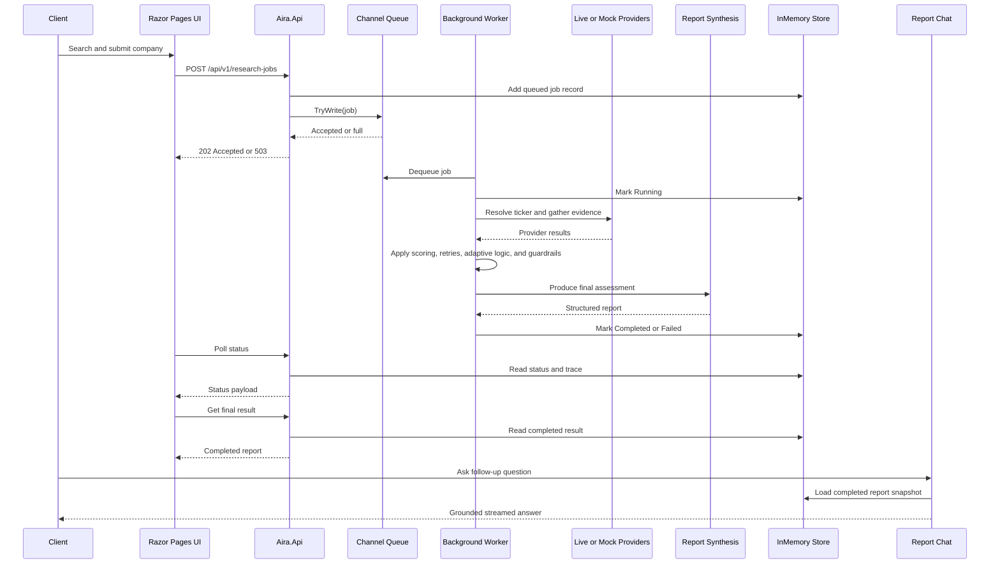

# A.I.R.A.

A.I.R.A. is an autonomous investment research backend built with .NET 8. It can analyze a publicly traded company, run the work asynchronously, show observable progress, return a structured report, and let the user chat with the completed report through a grounded OpenAI Responses flow.

The repository contains:

- a controller-based ASP.NET Core Web API
- a built-in Razor Pages UI
- a bounded background job pipeline
- mock, hybrid, and live execution paths
- a standard fixed workflow and an opt-in autonomous coordinator/specialist workflow
- report-grounded chat over SignalR

This implementation was built against the A.I.R.A. case-study goal of combining data retrieval, reasoning, structured outputs, and explainability in one backend service.

## Contents

- [What This Repo Does](#what-this-repo-does)
- [Current Product Shape](#current-product-shape)
- [Run Paths](#run-paths)
- [Architecture](#architecture)
- [Solution Structure](#solution-structure)
- [API Surface](#api-surface)
- [Job Lifecycle and Failure Behavior](#job-lifecycle-and-failure-behavior)
- [UI Flow](#ui-flow)
- [Research Modes](#research-modes)
- [Execution Modes](#execution-modes)
- [Agentic Workflow](#agentic-workflow)
- [Autonomous Mode](#autonomous-mode)
- [Data Sources](#data-sources)
- [Result Contract](#result-contract)
- [Report Chat](#report-chat)
- [Configuration](#configuration)
- [Run Locally](#run-locally)
- [Run With Live Providers](#run-with-live-providers)
- [Run Autonomous Mode](#run-autonomous-mode)
- [Run With Docker](#run-with-docker)
- [Testing and Validation](#testing-and-validation)
- [Trade-offs](#trade-offs)
- [Known Limitations](#known-limitations)
- [Extra Docs](#extra-docs)

## What This Repo Does

At a high level, A.I.R.A. supports this flow:

1. Search for a company or ticker.
2. Submit a research job.
3. Run the job asynchronously in the background.
4. Poll status and render live progress and trace.
5. Produce a structured investment-style JSON report.
6. Let the user chat with the completed report only.

The system is intentionally:

- unauthenticated
- in-memory
- non-durable across restarts
- reviewable and demo-friendly
- configurable from fully local mock mode up to live-provider plus model-backed mode

## Current Product Shape

The current implementation includes:

- async job submission and status polling
- a built-in web UI for submission, progress, report review, and chat
- structured JSON result output
- safe structured trace output
- provider provenance in the final report
- report-grounded chat over SignalR
- execution modes for `Mock`, `Hybrid`, `LiveRequired`, and `Auto`
- research modes for `Standard` and `Autonomous`
- any-US-ticker lookup through SEC mapping in the live path
- OpenAI Responses-based report synthesis, chat, coordinator, and specialist roles

## Run Paths

There are three practical ways to run the system.

### 1. No-key local demo path

Use this if you just cloned the repository and want the simplest working path.

- `ResearchJobs:Mode = Auto`
- `OpenAiResponses:Enabled = false`
- live providers disabled

Result:

- `Auto` resolves to `Mock`
- the built-in UI works
- the API works
- reports generate successfully
- provider provenance shows seeded mock data
- report chat stays disabled
- autonomous mode should not be used

See [QUICKSTART_NO_KEYS.md](./QUICKSTART_NO_KEYS.md).

### 2. Live standard path

Use this when you want live provider data and model-authored final reports.

- `ResearchJobs:Mode = LiveRequired` or `Auto`
- OpenAI Responses configured
- SEC, Twelve Data, and Alpha Vantage configured
- `researchMode = Standard`

Result:

- provider retrieval is live
- report synthesis is model-authored
- deterministic scoring still acts as a guardrail layer
- chat is available once the report completes

### 3. Autonomous path

Use this when you want the more agentic coordinator/specialist flow.

- OpenAI Responses configured
- `researchMode = Autonomous`
- execution mode typically `LiveRequired` or `Hybrid`

Result:

- a coordinator agent decides tool order and revisits
- explicit evidence-gap review is performed
- a specialist agent produces the final report
- critique and repair occur before final backend validation

## Architecture

The app is a single ASP.NET Core process with several runtime layers:

1. HTTP and UI layer
   - controllers
   - Razor Pages
   - SignalR hub
   - Swagger
   - global exception middleware
2. Application layer
   - validation
   - job submission and querying
   - orchestration
   - state transitions
   - result assembly
3. Domain layer
   - provider contracts
   - reasoner contracts
   - enums and domain models
   - deterministic scoring contracts
4. Infrastructure layer
   - in-memory job store
   - in-memory chat thread store
   - in-memory autonomous session store
   - bounded channel queue
   - live and mock providers
   - OpenAI Responses adapters
   - hosted worker
   - configuration binding

Core runtime sequence:

1. Submit request hits the API.
2. Identifier is validated and normalized.
3. A queued job record is written to the in-memory store.
4. The job is admitted to a bounded `Channel<T>` with `TryWrite`.
5. A hosted background worker dequeues and processes the job in a fresh DI scope.
6. The processor resolves execution mode and research mode.
7. Data is gathered from the configured source stack.
8. Deterministic assessment metrics are computed as guardrails.
9. The configured synthesis flow produces the final report.
10. The result is written back to the store.
11. The UI polls the status endpoint and renders the trace.
12. Once complete, chat can open against that exact stored report snapshot.

## Solution Structure

- `Aira.Api`
  - controllers
  - Razor Pages UI
  - SignalR hub
  - middleware
  - prompt files
  - composition root
- `Aira.Application`
  - orchestration
  - submission/query services
  - state machine
  - result/status models
  - report-chat orchestration
  - autonomous orchestration
- `Aira.Domain`
  - provider contracts
  - reasoner contracts
  - enums
  - domain models
  - deterministic scoring services
- `Aira.Infrastructure`
  - live provider clients
  - mock providers
  - queue/store implementations
  - hosted worker
  - Responses integrations
  - prompt providers
  - execution-mode resolution
  - ticker directory resolution
- `Aira.Tests.Unit`
  - validation
  - scoring
  - submission semantics
  - provider behavior
  - prompt loading
  - report chat services
  - autonomous coordinator logic
- `Aira.Tests.Integration`
  - API flows
  - UI rendering
  - SignalR chat flows

## API Surface

### Business endpoints

- `POST /api/v1/research-jobs`
- `GET /api/v1/research-jobs/{jobId}`
- `GET /api/v1/research-jobs/{jobId}/result`
- `GET /api/v1/tickers/search?q=...&limit=10`

### Operational endpoint

- `GET /health`

### SignalR endpoint

- `/hubs/report-chat`

### Submit a job

Request:

```json
{
  "identifier": "AAPL",
  "researchMode": "Standard"
}
```

Notes:

- `identifier` is required
- `researchMode` is optional
- allowed research modes are `Standard` and `Autonomous`
- if omitted, `Standard` is used

Success returns `202 Accepted`:

```json
{
  "jobId": "3f0f2b1d-92b4-4e77-8d7f-9c3a8d58e2aa",
  "status": "Queued",
  "createdAtUtc": "2026-03-18T10:00:00Z",
  "statusUrl": "/api/v1/research-jobs/3f0f2b1d-92b4-4e77-8d7f-9c3a8d58e2aa",
  "resultUrl": "/api/v1/research-jobs/3f0f2b1d-92b4-4e77-8d7f-9c3a8d58e2aa/result"
}
```

### Job status

`GET /api/v1/research-jobs/{jobId}`

Returns a status document that includes:

- job identity
- timestamps
- current step
- warnings
- live trace snapshot
- error if failed
- `researchMode`
- `activeAgent`
- `agentPhase`

Example:

```json
{
  "jobId": "3f0f2b1d-92b4-4e77-8d7f-9c3a8d58e2aa",
  "identifier": "AAPL",
  "status": "Running",
  "createdAtUtc": "2026-03-18T10:00:00Z",
  "startedAtUtc": "2026-03-18T10:00:01Z",
  "completedAtUtc": null,
  "currentStep": "QualityAssessment",
  "warnings": [],
  "trace": [],
  "error": null,
  "correlationId": "2b6b6f1e2d0445d59de16d7c2a3343eb",
  "researchMode": "Standard",
  "activeAgent": "None",
  "agentPhase": ""
}
```

### Job result

`GET /api/v1/research-jobs/{jobId}/result`

Returns:

- `202 Accepted` while queued or running
- `200 OK` with the completed report
- `409 Conflict` with `ProblemDetails` when the job failed
- `404 Not Found` with `ProblemDetails` when the job does not exist

### Ticker search

`GET /api/v1/tickers/search?q=ap&limit=10`

Example response:

```json
{
  "items": [
    {
      "symbol": "AAPL",
      "companyName": "Apple Inc.",
      "exchange": "Nasdaq",
      "cik": "0000320193"
    }
  ]
}
```

Notes:

- minimum query length is `2`
- the default limit is `10`
- the maximum limit is `20`

## Job Lifecycle and Failure Behavior

Public job states:

- `Queued`
- `Running`
- `Completed`
- `Failed`

Allowed transitions:

- `Queued -> Running`
- `Running -> Completed`
- `Running -> Failed`

Queue behavior:

- the queue is a bounded `Channel<ResearchJobQueueItem>`
- API admission uses `TryWrite`
- request threads never wait for queue capacity
- if the queue is full, the API returns `503 Service Unavailable`
- the provisional job record is removed if queue admission fails

Status and result behavior:

- `GET /api/v1/research-jobs/{jobId}` returns the latest state, step, warnings, live trace, and mode metadata
- `GET /api/v1/research-jobs/{jobId}/result` returns `202` until a terminal state exists
- failed jobs return `409` with `ProblemDetails`
- unknown jobs return `404`
- invalid request payloads return `400`
- unresolved or unsupported identifiers return `422`

Timeout behavior:

- `ResearchJobs__JobTimeoutMs` defaults to `90000`
- live jobs enforce a minimum effective timeout of 90 seconds so provider retrieval and synthesis are not cut off too aggressively

All non-success API errors use RFC 7807 `ProblemDetails`.

## UI Flow

The built-in UI is served from `Aira.Api` and is part of the same app.

### Pages

- `/`
  - company search
  - research mode selection
  - job submission
- `/reports/{jobId}`
  - live progress
  - report rendering
  - provider provenance
  - progress drawer
  - grounded chat once the report is ready

### UX sequence

1. Search for a company or ticker.
2. Choose `Standard` or `Autonomous`.
3. Submit the job.
4. Watch the progress bar, current status, and trace timeline.
5. Review the completed report.
6. Chat with the report once the thread is ready.

The status page keeps the progress panel secondary so the report remains the main focus after completion.

## Research Modes

Research mode controls how the report is orchestrated.

### `Standard`

This is the stable fixed pipeline.

It always follows the same high-level sequence:

1. identifier resolution
2. research plan creation
3. source collection
4. quality assessment
5. adaptive branching
6. synthesis
7. final reflection
8. completion

Use `Standard` when:

- running without keys
- demonstrating the simplest path
- you want predictable orchestration

### `Autonomous`

This is the advanced multi-agent path.

It uses:

- a Responses-based coordinator agent
- bounded internal tools only
- explicit evidence-gap review
- specialist handoff
- specialist critique and repair

Use `Autonomous` when:

- OpenAI Responses is configured
- you want to demonstrate stronger agent behavior
- you want the coordinator/specialist handoff flow

## Execution Modes

Execution mode controls the provider and fallback strategy.

### `Mock`

- use seeded data only
- deterministic and no-key friendly

### `Hybrid`

- prefer live providers
- allow seeded fallback
- fallback is explicit in provenance and trace

### `LiveRequired`

- use live providers only
- seeded fallback is disabled for main report generation
- critical live-source failure fails the job
- non-critical live-source failure degrades the report

### `Auto`

Default behavior:

- resolve to `Mock` when the live provider stack or report-synthesis model is not fully configured
- resolve to `LiveRequired` when the live and model stack is configured

This makes the repo safe for fresh local clones while still allowing full live execution in configured environments.

## Agentic Workflow

The standard workflow uses these public step names:

1. `IdentifierResolution`
2. `ResearchPlanCreation`
3. `ParallelSourceCollection`
4. `QualityAssessment`
5. `AdaptiveBranching`
6. `Synthesis`
7. `FinalReflection`
8. `Completion`

Trace-only special steps:

- `ProviderRetry`
- `ProviderFallback`

The standard flow is still genuinely multi-step:

- it decides what domains are needed
- it collects from multiple sources independently
- it adapts to missing data, retries, contradictions, and low-news conditions
- it synthesizes the final report only after the evidence package is assembled

## Autonomous Mode

Autonomous mode adds a more model-driven orchestration path.

### Coordinator role

The coordinator:

- resolves the ticker
- decides tool order
- revisits tools when needed
- gathers evidence
- reviews evidence gaps
- decides when to hand off

Approved internal tools are bounded to the tool registry. There is no open web browsing.

Tool catalog:

- `resolveTicker`
- `getCompanyProfile`
- `getMarketSnapshot`
- `getFinancialStatements`
- `getNewsCoverage`
- `getFilingCoverage`
- `getEvidenceStatus`
- `handoffToSpecialist`

### Specialist role

The specialist receives a handoff packet only. It does not call live-provider tools directly.

The handoff packet includes:

- resolved company identity
- evidence summary
- source catalog and provenance
- warnings and missing-source notes
- deterministic guardrail metrics
- coordinator plan summary
- unresolved questions and contradictions

The specialist is responsible for:

- `signal`
- `confidence`
- `thesis`
- `insights`
- `thesisDetails`
- `insightDetails`
- `signalDetails`
- `confidenceDetails`

### Reflection phases

Autonomous trace phases include:

- `CoordinatorPlanning`
- `CoordinatorToolExecution`
- `EvidenceGapReview`
- `ContradictionReview`
- `SpecialistHandoff`
- `SpecialistDraft`
- `SpecialistCritique`
- `OutputValidation`

### Validation authority

Even in autonomous mode, backend validation remains final authority:

- cited source ids must exist
- `signal` must be valid
- `confidence` must be `0..100`
- `insights` must be between `2` and `5`
- `evidenceScore < 55` forces a final backend `Neutral` override
- confidence is bounded by deterministic guardrails

## Data Sources

### Live sources

- SEC EDGAR
  - ticker resolution
  - company identity
  - filings
  - most financial statements
- Twelve Data
  - market snapshot
- Alpha Vantage
  - news coverage

### Mock sources

The seeded mock catalog covers:

- `AAPL`
- `MSFT`
- `NVDA`
- `TSLA`
- `JPM`
- `AMZN`
- `GOOGL`
- `AMD`
- `XOM`
- `UNH`

In `Mock` mode, the app is fully deterministic and does not need external APIs.

### TSLA degraded scenario

`TSLA` is the locked degraded seed path and behaves as follows per job execution:

- market snapshot fails once with `TransientFailure`
- retry succeeds
- news coverage is sparse and low quality
- final signal becomes `Neutral`

Required warnings include:

- `Market snapshot required retry before successful retrieval.`
- `Low news coverage reduced narrative confidence.`

## Result Contract

Every completed report includes the original required top-level keys:

```json
{
  "company": "...",
  "thesis": "...",
  "signal": "...",
  "insights": [],
  "sources": []
}
```

The current implementation extends that schema with rich explainability data.

### Current completed result shape

```json
{
  "company": "Apple Inc.",
  "identifier": "AAPL",
  "thesis": "Apple combines ecosystem stickiness and services monetization with high margins and recurring services revenue support resilient cash generation, while hardware upgrade concentration remains the main offset.",
  "signal": "Bullish",
  "confidence": 91,
  "generatedAtUtc": "2026-03-18T10:00:12Z",
  "insights": [
    "Apple Inc. is converting revenue into strong cash generation and operating leverage.",
    "Recent coverage remains constructive, led by themes such as services growth continues to outpace hardware.",
    "Primary risk remains hardware upgrade concentration, but the current evidence still favors upside."
  ],
  "sources": [
    "financials:AAPL",
    "profile:AAPL",
    "filing:AAPL:001",
    "news:AAPL:001"
  ],
  "warnings": [],
  "trace": [],
  "sourceDetails": [],
  "providerUsage": [],
  "insightDetails": [],
  "thesisDetails": {
    "summary": "Thesis rests on strong financial execution, company positioning, and corroborating disclosures.",
    "sourceIds": [
      "financials:AAPL",
      "profile:AAPL",
      "filing:AAPL:001"
    ]
  },
  "signalDetails": {
    "signal": "Bullish",
    "rationale": "The evidence package supports a positive directional conclusion without violating the conservative override rules.",
    "sourceIds": [
      "financials:AAPL",
      "filing:AAPL:001"
    ],
    "overrideApplied": false
  },
  "confidenceDetails": {
    "rationale": "Confidence is high because the evidence is complete, coherent, and well supported by cited sources.",
    "boundedFrom": 82,
    "boundedTo": 92,
    "sourceIds": [
      "financials:AAPL",
      "profile:AAPL",
      "filing:AAPL:001"
    ]
  },
  "synthesisDetails": {
    "mode": "LiveRequired",
    "model": "gpt-5.4-nano",
    "validationRetries": 0,
    "fallbackOccurred": false
  },
  "orchestrationDetails": {
    "researchMode": "Autonomous",
    "coordinatorModel": "gpt-5.4-nano",
    "specialistModel": "gpt-5.4-nano",
    "handoffOccurred": true,
    "toolCallCount": 8,
    "reflectionRounds": 2,
    "validationRetries": 0
  }
}
```

### Provenance and traceability

The result explicitly captures:

- `providerUsage`
  - one entry per domain
  - origin, provider name, fallback state, and fallback reason
- `sourceDetails`
  - source type, title, timestamp, provider origin, provider name, fallback state
- `insightDetails`
  - source ids for each insight
- `thesisDetails`
  - source ids supporting the thesis
- `signalDetails`
  - signal rationale and whether an override was applied
- `confidenceDetails`
  - confidence rationale and the bounded range
- `synthesisDetails`
  - synthesis mode, model, retries, fallback state
- `orchestrationDetails`
  - standard vs autonomous orchestration metadata

### Trace semantics

Each trace item includes:

- `step`
- `status`
- `summary`
- `sourceIds`
- `timestampUtc`

Trace entries are intentionally safe:

- they expose what the system did
- they do not expose hidden chain-of-thought

## Report Chat

The report chat is a separate Responses-based layer on top of a completed report.

### Design rules

- chat is available only for completed jobs
- each chat thread is app-owned
- each chat thread is bound to one completed report snapshot
- chat does not trigger fresh research
- chat does not browse the web
- chat answers only from the completed report

### Transport

- SignalR hub: `/hubs/report-chat`

Hub methods:

- `CreateThread(Guid jobId)`
- `SendMessage(string threadId, string message)`
- `ResumeStream(string threadId, long lastSequence)`
- `CancelStream(string threadId)`

### Grounding tools

The chat model can use:

- `getReportSummary()`
- `getSourceDetails(sourceIds[])`
- `getInsightEvidence(insightIndexes[])`
- `getTrace(step?, limit?)`
- `getProviderUsage()`

### Thread behavior

- in-memory only
- expires after `60` minutes of inactivity
- stores transcript and `previousResponseId`
- survives within the running app only

## Configuration

Configuration comes from:

- `Aira.Api/appsettings.json`
- `Aira.Api/appsettings.Development.json`
- environment variables
- `.env.example`
- ASP.NET user-secrets if you choose to use them locally

### Main settings

#### Research jobs

- `ResearchJobs__QueueCapacity`
- `ResearchJobs__MaxConcurrentJobs`
- `ResearchJobs__ProviderTimeoutMs`
- `ResearchJobs__RetryDelayMs`
- `ResearchJobs__MaxRetries`
- `ResearchJobs__JobTimeoutMs`
- `ResearchJobs__OverloadRetryAfterSeconds`
- `ResearchJobs__Mode`
- `ResearchJobs__TickerSearchMinimumQueryLength`
- `ResearchJobs__TickerSearchDefaultLimit`
- `ResearchJobs__TickerSearchMaxLimit`

#### OpenAI Responses

- `OpenAiResponses__Enabled`
- `OpenAiResponses__ApiKey`
- `OpenAiResponses__BaseUrl`
- `OpenAiResponses__Model`
- `OpenAiResponses__ReportModel`
- `OpenAiResponses__ChatModel`
- `OpenAiResponses__CoordinatorModel`
- `OpenAiResponses__SpecialistModel`
- `OpenAiResponses__TimeoutSeconds`
- `OpenAiResponses__EnableStreaming`
- `OpenAiResponses__MaxToolRounds`
- `OpenAiResponses__PromptFilePath`
- `OpenAiResponses__ReportPromptFilePath`
- `OpenAiResponses__ChatPromptFilePath`
- `OpenAiResponses__CoordinatorPromptFilePath`
- `OpenAiResponses__SpecialistPromptFilePath`
- `OpenAiResponses__ReportValidationRetries`
- `OpenAiResponses__CoordinatorMaxToolRounds`
- `OpenAiResponses__SpecialistCritiqueRetries`
- `OpenAiResponses__AllowAutonomousStandardFallback`

#### SEC EDGAR

- `SecEdgar__Enabled`
- `SecEdgar__DataBaseUrl`
- `SecEdgar__MappingUrl`
- `SecEdgar__UserAgent`

#### Twelve Data

- `TwelveData__Enabled`
- `TwelveData__BaseUrl`
- `TwelveData__ApiKey`

#### Alpha Vantage

- `AlphaVantage__Enabled`
- `AlphaVantage__BaseUrl`
- `AlphaVantage__ApiKey`

### Important defaults

- `ResearchJobs__Mode = Auto`
- `OpenAiResponses__Enabled = false`
- live providers disabled by default
- `ResearchJobs__JobTimeoutMs = 90000`
- `OpenAiResponses` default models are `gpt-5.4-nano`

### Example hybrid-live setup

```bash
ResearchJobs__Mode=Hybrid
SecEdgar__Enabled=true
SecEdgar__UserAgent="AIRA/1.0 you@example.com"
TwelveData__Enabled=true
TwelveData__ApiKey=your_twelve_data_key
AlphaVantage__Enabled=true
AlphaVantage__ApiKey=your_alpha_vantage_key
```

### Example live-required setup

```bash
ResearchJobs__Mode=LiveRequired
OpenAiResponses__Enabled=true
OpenAiResponses__ApiKey=your_openai_key
OpenAiResponses__ReportModel=gpt-5.4-nano
OpenAiResponses__ChatModel=gpt-5.4-nano
SecEdgar__Enabled=true
SecEdgar__UserAgent="AIRA/1.0 you@example.com"
TwelveData__Enabled=true
TwelveData__ApiKey=your_twelve_data_key
AlphaVantage__Enabled=true
AlphaVantage__ApiKey=your_alpha_vantage_key
```

### Example autonomous setup

```bash
ResearchJobs__Mode=LiveRequired
OpenAiResponses__Enabled=true
OpenAiResponses__ApiKey=your_openai_key
OpenAiResponses__CoordinatorModel=gpt-5.4-nano
OpenAiResponses__SpecialistModel=gpt-5.4-nano
OpenAiResponses__AllowAutonomousStandardFallback=false
SecEdgar__Enabled=true
SecEdgar__UserAgent="AIRA/1.0 you@example.com"
TwelveData__Enabled=true
TwelveData__ApiKey=your_twelve_data_key
AlphaVantage__Enabled=true
AlphaVantage__ApiKey=your_alpha_vantage_key
```

## Run Locally

### Fastest no-key path

From the repository root:

```bash
dotnet restore
dotnet build Aira.sln
dotnet run --project Aira.Api --launch-profile http
```

Open:

- `http://localhost:5214/`
- `http://localhost:5214/swagger`
- `http://localhost:5214/health`

Recommended for this path:

- choose `Standard`
- keep defaults
- expect mock-backed reports
- expect chat to remain disabled

### Development URLs

Current launch profiles:

- `http://localhost:5214`
- `https://localhost:7004`

## Run With Live Providers

To get live provider data, configure:

- `SecEdgar`
- `TwelveData`
- `AlphaVantage`

Recommended mode:

- `ResearchJobs__Mode = LiveRequired`

Notes:

- SEC requires a valid `User-Agent`
- live provider failures can fail or degrade the report depending on criticality
- `LiveRequired` disables seeded fallback for main report generation

## Run Autonomous Mode

To use `Autonomous` mode, configure:

- `OpenAiResponses__Enabled=true`
- `OpenAiResponses__ApiKey`
- `OpenAiResponses__CoordinatorModel`
- `OpenAiResponses__SpecialistModel`

Then submit:

```json
{
  "identifier": "AAPL",
  "researchMode": "Autonomous"
}
```

Recommended setup:

- `ResearchJobs__Mode = LiveRequired`
- live providers enabled
- `OpenAiResponses__AllowAutonomousStandardFallback=false`

Without OpenAI configured:

- autonomous mode should be considered unavailable

## Run With Docker

Build:

```bash
docker build -t aira-backend .
```

Run:

```bash
docker run --rm -p 8080:8080 aira-backend
```

Run with live-required config:

```bash
docker run --rm -p 8080:8080 \
  -e ResearchJobs__Mode=LiveRequired \
  -e OpenAiResponses__Enabled=true \
  -e OpenAiResponses__ApiKey=... \
  -e OpenAiResponses__ReportModel=gpt-5.4-nano \
  -e OpenAiResponses__ChatModel=gpt-5.4-nano \
  -e SecEdgar__Enabled=true \
  -e SecEdgar__UserAgent="AIRA/1.0 you@example.com" \
  -e TwelveData__Enabled=true \
  -e TwelveData__ApiKey=... \
  -e AlphaVantage__Enabled=true \
  -e AlphaVantage__ApiKey=... \
  aira-backend
```

The container listens on port `8080`.

## Testing and Validation

Run the full suite:

```bash
dotnet test Aira.sln
```

Current validation status from the latest full pass:

- `dotnet build Aira.sln` passed
- `dotnet test Aira.sln` passed
- 41 tests total
  - 26 unit
  - 15 integration

The test suite covers:

- identifier validation
- queue admission and overload behavior
- state transitions
- deterministic scoring rules
- live-provider hybrid behavior
- report synthesis validation and repair mapping
- prompt loading
- report chat thread expiry and tool loop behavior
- Razor Pages rendering
- SignalR report chat flows
- standard and autonomous end-to-end flows

## Trade-offs

- In-memory storage keeps the system simple and easy to review, but jobs and sessions are lost on restart.
- Mock mode gives a reliable demo path, but it is not live market truth.
- Hybrid mode is pragmatic, but it mixes live and seeded data by design.
- LiveRequired mode is closer to the target production behavior, but it is more exposed to rate limits and upstream failures.
- Deterministic scoring is retained as a guardrail layer even when the final report is model-authored.
- The autonomous path is more agentic, but it is also more complex and more dependent on bounded prompt and tool discipline.
- The UI is convenient for review and demos, but the core system is still backend-first.

## Known Limitations

- Jobs are lost on restart.
- Queue capacity is finite.
- Queue overload returns `503 Service Unavailable`.
- There is no persistence layer.
- There is no authentication or authorization.
- There is no user cancel API for research jobs.
- There is no distributed worker architecture.
- Live analysis depends on external APIs and may degrade or fail when providers are slow, unavailable, or rate-limited.
- Mock mode uses a finite seeded catalog.
- Recurring monitoring is intentionally deferred.
- Autonomous mode is bounded to approved internal tools and does not browse the open web.

## Extra Docs

Additional repository docs:

- [QUICKSTART_NO_KEYS.md](./QUICKSTART_NO_KEYS.md)
  - quickest clone-and-run path without any secrets
- [CASE_STUDY_COVERAGE.md](./CASE_STUDY_COVERAGE.md)
  - requirement-by-requirement coverage against the original case study

## Sequence Diagram


