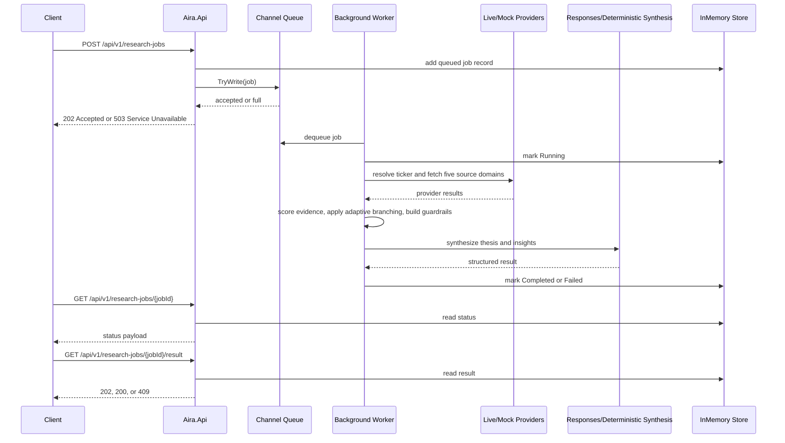

# A.I.R.A. Backend v1

## Overview
A.I.R.A. is a .NET 8 application that exposes both a backend API and a built-in Razor Pages UI. Users can search for a US-listed operating company, launch an asynchronous research job, watch the trace evolve live through polling, inspect the completed report, and then chat with that completed report through a SignalR-based report-chat experience.

Version 1 is intentionally:

- local and demo oriented
- unauthenticated
- in-memory
- execution-mode driven
- mock-data backed in `mock` mode
- live-provider backed in `live_required` mode
- non-durable across restarts

The service exposes the core research endpoints plus one lookup endpoint:

- `POST /api/v1/research-jobs`
- `GET /api/v1/research-jobs/{jobId}`
- `GET /api/v1/research-jobs/{jobId}/result`
- `GET /api/v1/tickers/search?q=...&limit=10`

It also exposes one operational endpoint:

- `GET /health`

And one SignalR chat endpoint for the built-in report chat UI:

- `/hubs/report-chat`

## Architecture
The application uses a controller-based ASP.NET Core Web API plus Razor Pages on top of an in-process asynchronous job pipeline.

Core runtime flow:

1. The API validates and normalizes an identifier.
2. A job record is written to an in-memory store.
3. The job is admitted to a bounded `Channel<T>` queue with non-blocking `TryWrite`.
4. A hosted background worker dequeues jobs and creates a per-job DI scope.
5. The orchestrator resolves the execution mode, collects provider data, applies retry/adaptive logic, computes deterministic guardrail metrics, and invokes the configured report-synthesis reasoner.
6. The final result is stored in memory and later returned by the result endpoint.
7. The report UI polls the status endpoint and renders the current trace timeline.
8. Once the report is complete, the UI can open a SignalR chat session bound to that exact completed report snapshot.

The provider layer now supports four execution modes:

- `mock`: use seeded providers and deterministic synthesis only
- `hybrid`: prefer live providers, but allow seeded fallback with explicit provenance
- `live_required`: use live providers only and fail or degrade without seeded fallback
- `auto`: choose `mock` when the live provider stack or report-synthesis model is incomplete; otherwise choose `live_required`

Research flow modes:

- `Standard`: the stable fixed-domain pipeline already in production
- `Autonomous`: a Responses-based coordinator agent gathers evidence through bounded internal tools, runs explicit evidence-gap review, then hands off to a stock-report specialist agent for final synthesis

Live provider stack:

- SEC EDGAR for ticker resolution, company identity, filings, and financial statements
- Twelve Data for market snapshots
- Alpha Vantage for news coverage
- seeded mocks remain available for `mock` mode and `hybrid` fallback only

Agent observability is exposed through:

- structured logs with `jobId`, `identifier`, `correlationId`, and `step`
- a safe `trace` array in the final result
- a live `trace` snapshot in the status response
- report-chat stream events over SignalR for grounded follow-up answers

## Project Structure
- `Aira.Api`: controllers, Razor Pages UI, SignalR hub, HTTP pipeline, Swagger, middleware, composition root
- `Aira.Application`: orchestration, validation, job lifecycle, result assembly
- `Aira.Domain`: domain models, enums, provider contracts, reasoner contracts, scoring rules
- `Aira.Infrastructure`: in-memory store, queue, hosted worker, seeded providers, live-provider clients, deterministic guardrails, Responses-based report synthesis, prompt loaders, report-chat services, in-memory thread store
- `Aira.Tests.Unit`: unit coverage for validation, scoring, selection, state transitions, and submission semantics
- `Aira.Tests.Integration`: API, Razor Pages, and SignalR coverage for happy path, degraded path, failure path, overload behavior, fallback behavior, and report chat

## API Endpoints
### Search tickers
`GET /api/v1/tickers/search?q=ap&limit=10`

Response:

```json
{
  "items": [
    {
      "symbol": "AAPL",
      "companyName": "Apple Inc.",
      "exchange": "Nasdaq",
      "cik": "0000320193"
    }
  ]
}
```

### Submit a job
`POST /api/v1/research-jobs`

Request:

```json
{
  "identifier": "AAPL",
  "researchMode": "Standard"
}
```

`researchMode` is optional. Allowed values:

- `Standard` (default)
- `Autonomous`

Success:

- `202 Accepted`
- `Location: /api/v1/research-jobs/{jobId}`

```json
{
  "jobId": "3f0f2b1d-92b4-4e77-8d7f-9c3a8d58e2aa",
  "status": "Queued",
  "createdAtUtc": "2026-03-18T10:00:00Z",
  "statusUrl": "/api/v1/research-jobs/3f0f2b1d-92b4-4e77-8d7f-9c3a8d58e2aa",
  "resultUrl": "/api/v1/research-jobs/3f0f2b1d-92b4-4e77-8d7f-9c3a8d58e2aa/result"
}
```

### Check job status
`GET /api/v1/research-jobs/{jobId}`

Success:

```json
{
  "jobId": "3f0f2b1d-92b4-4e77-8d7f-9c3a8d58e2aa",
  "identifier": "AAPL",
  "status": "Running",
  "createdAtUtc": "2026-03-18T10:00:00Z",
  "startedAtUtc": "2026-03-18T10:00:01Z",
  "completedAtUtc": null,
  "currentStep": "QualityAssessment",
  "warnings": [],
  "trace": [],
  "error": null,
  "correlationId": "2b6b6f1e2d0445d59de16d7c2a3343eb",
  "researchMode": "Standard",
  "activeAgent": "None",
  "agentPhase": ""
}
```

### Get final result
`GET /api/v1/research-jobs/{jobId}/result`

Responses:

- `202 Accepted` while queued or running
- `200 OK` with the completed result payload
- `409 Conflict` with `ProblemDetails` when the job failed
- `404 Not Found` with `ProblemDetails` when the job does not exist

### Built-in UI
Development launches into the built-in UI at `/` by default.

Pages:

- `/` for ticker selection and async job submission
- `/reports/{jobId}` for progress polling, completed report rendering, and `Chat with this report`

### Report chat hub
`/hubs/report-chat`

Hub methods:

- `CreateThread(Guid jobId)`
- `SendMessage(string threadId, string message)`
- `ResumeStream(string threadId, long lastSequence)`
- `CancelStream(string threadId)`

## Async Job Lifecycle
The public job states are:

- `Queued`
- `Running`
- `Completed`
- `Failed`

Allowed transitions are:

- `Queued -> Running`
- `Running -> Completed`
- `Running -> Failed`

Jobs are processed asynchronously by a hosted background worker. Submission is non-blocking: the request thread never waits for queue capacity. When the queue is full, the API returns `503 Service Unavailable` instead of stalling.

The built-in `/reports/{jobId}` page polls the status endpoint every 2 seconds while the job is non-terminal and renders the current `trace` as a progress timeline.

## Queue Admission and Overload Behavior
The queue is a bounded `Channel<ResearchJobQueueItem>` with:

- `QueueCapacity = 100` by default
- `FullMode = Wait`
- `TryWrite` admission semantics at the API boundary

Submission order is:

1. validate identifier
2. allocate `jobId` and `correlationId`
3. write the provisional record to the store
4. attempt `TryWrite`
5. remove the record if queue admission fails
6. return `202` or `503`

Queue-full failure example:

```json
{
  "type": "/problems/queue-capacity-exceeded",
  "title": "Queue capacity exceeded.",
  "status": 503,
  "detail": "The service is temporarily unable to accept additional research jobs.",
  "instance": "/api/v1/research-jobs",
  "traceId": "0HN1234567890:00000001",
  "errorCode": "QueueCapacityExceeded"
}
```

The response also includes:

- `Retry-After: 5`

## Agent Workflow
The workflow uses these public step names:

1. `IdentifierResolution`
2. `ResearchPlanCreation`
3. `ParallelSourceCollection`
4. `QualityAssessment`
5. `AdaptiveBranching`
6. `Synthesis`
7. `FinalReflection`
8. `Completion`

Trace-only special steps:

- `ProviderRetry`
- `ProviderFallback`

Autonomous-only trace phases:

- `CoordinatorPlanning`
- `CoordinatorToolExecution`
- `EvidenceGapReview`
- `ContradictionReview`
- `SpecialistHandoff`
- `SpecialistDraft`
- `SpecialistCritique`
- `OutputValidation`

The workflow does real orchestration rather than one-shot prompting:

- it plans the required domains
- collects each source independently
- retries according to source-specific policy
- scores evidence quality and direction
- adapts weights and warnings based on intermediate conditions
- synthesizes a structured report through the Responses API
- validates source linkage, signal constraints, and confidence bounds before finalizing

In `Autonomous` mode, the orchestration is explicitly split:

- a `Coordinator` agent decides tool order and revisits using only approved internal tools
- an evidence-gap review runs before handoff
- a `Stock Report Specialist` agent receives only the handoff packet, writes the draft, critiques it once, and repairs once if needed
- backend validation remains the final authority on citations, signal values, confidence bounds, and schema shape

Once a report reaches `Completed`, the separate report-chat flow can answer follow-up questions. That chat is intentionally bounded to the completed report only and never triggers fresh research in v1.

## Adaptive Branching Rules
The implementation applies these locked rules:

- critical source missing after final attempt: fail the job
- non-critical source missing after final attempt: continue with warning and lower confidence
- market snapshot retries on transient failure
- low-news mode activates when news quality is below `0.40` or fewer than two news items exist
- low-news mode reduces news weight and shifts weight toward financial statements and filings
- unresolved contradiction lowers confidence and is reflected in trace
- `evidenceScore < 55` forces a `Neutral` final signal
- OpenAI misconfiguration triggers deterministic fallback plus warning and `ProviderFallback`

## Deterministic Guardrails
Baseline weights:

- `CompanyProfile = 0.10`
- `MarketSnapshot = 0.15`
- `FinancialStatement = 0.30`
- `News = 0.20`
- `FilingExcerpt = 0.25`

Low-news weights:

- `CompanyProfile = 0.10`
- `MarketSnapshot = 0.15`
- `FinancialStatement = 0.40`
- `News = 0.10`
- `FilingExcerpt = 0.25`

Core formulas:

- `completenessScore = round(sum(weight * availability) * 100)`
- `evidenceScore = round(sum(weight * availability * qualityScore) * 100)`
- `directionalScore = round(sum(weight * availability * qualityScore * stanceScore) * 100)`
- `agreementScore = round((1 - contradictionScore) * 100)`
- `confidence = clamp(baseConfidence - penalties, 0, 100)`

Signal rules:

- `evidenceScore < 55` => `Neutral`
- `directionalScore >= 20` => `Bullish`
- `directionalScore <= -20` => `Bearish`
- otherwise => `Neutral`

## Data Coverage
In live execution, A.I.R.A can analyze any US-listed operating company that can be resolved through the SEC ticker/company mapping and supported by the configured live providers.

In mock execution, the built-in seeded catalog currently covers:

- `AAPL`
- `MSFT`
- `NVDA`
- `TSLA`
- `JPM`
- `AMZN`
- `GOOGL`
- `AMD`
- `XOM`
- `UNH`

Seeded mode includes:

- company profile
- market snapshot
- financial statements
- news coverage
- filing excerpts

The seeded dataset is deterministic and checked into code. No live APIs are required for `mock` mode.

Live-provider rollout:

- `SecEdgar` resolves tickers and supplies company identity, filings, and most financial statements
- `TwelveData` supplies market snapshots
- `AlphaVantage` supplies news coverage
- company profile is factual in live mode; seeded narrative scaffolding is not used in `live_required`

## TSLA Degraded Scenario
`TSLA` is the designated degraded scenario.

Behavior per job execution:

- market snapshot fails once with `TransientFailure`
- the retry succeeds
- news coverage contains exactly one low-quality item
- the final signal is `Neutral`

Required final warnings:

- `Market snapshot required retry before successful retrieval.`
- `Low news coverage reduced narrative confidence.`

Required trace characteristics:

- one `ProviderRetry`
- one `AdaptiveBranching`
- one `FinalReflection`

## Result Schema
Every completed result includes:

```json
{
  "company": "Apple Inc.",
  "identifier": "AAPL",
  "thesis": "Apple combines ecosystem stickiness and services monetization with high margins and recurring services revenue support resilient cash generation, while hardware upgrade concentration remains the main offset.",
  "signal": "Bullish",
  "confidence": 91,
  "generatedAtUtc": "2026-03-18T10:00:12Z",
  "insights": [
    "Apple Inc. is converting revenue into strong cash generation and operating leverage.",
    "Recent coverage remains constructive, led by themes such as services growth continues to outpace hardware.",
    "Primary risk remains hardware upgrade concentration, but the current evidence still favors upside."
  ],
  "sources": [
    "financials:AAPL",
    "profile:AAPL",
    "filing:AAPL:001",
    "news:AAPL:001"
  ],
  "warnings": [],
  "trace": [],
  "sourceDetails": [],
  "providerUsage": [],
  "insightDetails": [],
  "thesisDetails": {
    "summary": "Thesis rests on strong financial execution, company positioning, and corroborating disclosures.",
    "sourceIds": [
      "financials:AAPL",
      "profile:AAPL",
      "filing:AAPL:001"
    ]
  },
  "signalDetails": {
    "signal": "Bullish",
    "rationale": "The evidence package supports a positive directional conclusion without violating the conservative override rules.",
    "sourceIds": [
      "financials:AAPL",
      "filing:AAPL:001"
    ],
    "overrideApplied": false
  },
  "confidenceDetails": {
    "rationale": "Confidence is high because the evidence is complete, coherent, and well supported by cited sources.",
    "boundedFrom": 82,
    "boundedTo": 92,
    "sourceIds": [
      "financials:AAPL",
      "profile:AAPL",
      "filing:AAPL:001"
    ]
  },
  "synthesisDetails": {
    "mode": "LiveRequired",
    "model": "gpt-5.4-nano",
    "validationRetries": 0,
    "fallbackOccurred": false
  },
  "orchestrationDetails": {
    "researchMode": "Autonomous",
    "coordinatorModel": "gpt-5.4-nano",
    "specialistModel": "gpt-5.4-nano",
    "handoffOccurred": true,
    "toolCallCount": 8,
    "reflectionRounds": 2,
    "validationRetries": 0
  }
}
```

Provider provenance is now explicit:

- `providerUsage` reports one entry per domain with `domain`, `status`, `origin`, `providerName`, `fallbackOccurred`, and `fallbackReason`
- every `sourceDetails` item includes `providerOrigin`, `providerName`, and `fallbackOccurred`
- `trace` includes explicit summaries such as `...was collected from live provider SEC EDGAR.` or `...used seeded mock fallback via SeededMock.`
- `signalDetails`, `confidenceDetails`, and `synthesisDetails` explain the final assessment without exposing hidden chain-of-thought
- `orchestrationDetails` records whether the report came from the standard pipeline or the autonomous coordinator/specialist handoff path

## Trace Semantics
Each trace item contains:

- `step`
- `status`
- `summary`
- `sourceIds`
- `timestampUtc`

Trace values are intentionally safe. They show:

- observable actions
- retry decisions
- fallback decisions
- evidence weighting decisions
- confidence-related reflections

Trace values do not expose hidden chain-of-thought.

## Report Chat
The report chat experience is a separate OpenAI Responses-based explainer layer that sits on top of a completed report.

Key design rules:

- chat is available only for completed jobs
- each chat thread is app-owned and tied to one completed report snapshot
- chat is grounded only in the stored report, not in live providers or external browsing
- the model can use report-grounding tools for source details, insight evidence, trace entries, and provider usage
- chat threads are in-memory only and expire after 60 minutes of inactivity

Grounding tools available to the model:

- `getReportSummary()`
- `getSourceDetails(sourceIds[])`
- `getInsightEvidence(insightIndexes[])`
- `getTrace(step?, limit?)`
- `getProviderUsage()`

The chat prompt is loaded from `Aira.Api/Prompts/report-chat-system-prompt.txt`.

## Configuration
Configuration comes from:

- `Aira.Api/appsettings.json`
- `Aira.Api/appsettings.Development.json`
- environment variables
- `.env.example`

Relevant keys:

- `ResearchJobs__QueueCapacity`
- `ResearchJobs__MaxConcurrentJobs`
- `ResearchJobs__ProviderTimeoutMs`
- `ResearchJobs__RetryDelayMs`
- `ResearchJobs__MaxRetries`
- `ResearchJobs__JobTimeoutMs`
- `ResearchJobs__OverloadRetryAfterSeconds`
- `ResearchJobs__Mode`
- `ResearchJobs__TickerSearchMinimumQueryLength`
- `ResearchJobs__TickerSearchDefaultLimit`
- `ResearchJobs__TickerSearchMaxLimit`
- `OpenAiResponses__Enabled`
- `OpenAiResponses__ApiKey`
- `OpenAiResponses__BaseUrl`
- `OpenAiResponses__Model`
- `OpenAiResponses__ReportModel`
- `OpenAiResponses__ChatModel`
- `OpenAiResponses__CoordinatorModel`
- `OpenAiResponses__SpecialistModel`
- `OpenAiResponses__TimeoutSeconds`
- `OpenAiResponses__EnableStreaming`
- `OpenAiResponses__MaxToolRounds`
- `OpenAiResponses__PromptFilePath`
- `OpenAiResponses__ReportPromptFilePath`
- `OpenAiResponses__ChatPromptFilePath`
- `OpenAiResponses__CoordinatorPromptFilePath`
- `OpenAiResponses__SpecialistPromptFilePath`
- `OpenAiResponses__ReportValidationRetries`
- `OpenAiResponses__CoordinatorMaxToolRounds`
- `OpenAiResponses__SpecialistCritiqueRetries`
- `OpenAiResponses__AllowAutonomousStandardFallback`
- `SecEdgar__Enabled`
- `SecEdgar__DataBaseUrl`
- `SecEdgar__MappingUrl`
- `SecEdgar__UserAgent`
- `TwelveData__Enabled`
- `TwelveData__BaseUrl`
- `TwelveData__ApiKey`
- `AlphaVantage__Enabled`
- `AlphaVantage__BaseUrl`
- `AlphaVantage__ApiKey`

Example hybrid-live configuration:

```bash
ResearchJobs__Mode=Hybrid
SecEdgar__Enabled=true
SecEdgar__UserAgent="AIRA/1.0 you@example.com"
TwelveData__Enabled=true
TwelveData__ApiKey=your_twelve_data_key
AlphaVantage__Enabled=true
AlphaVantage__ApiKey=your_alpha_vantage_key
```

Example live-required configuration:

```bash
ResearchJobs__Mode=LiveRequired
OpenAiResponses__Enabled=true
OpenAiResponses__ApiKey=your_openai_key
OpenAiResponses__ReportModel=gpt-5.4-nano
OpenAiResponses__ChatModel=gpt-5.4-nano
SecEdgar__Enabled=true
SecEdgar__UserAgent="AIRA/1.0 you@example.com"
TwelveData__Enabled=true
TwelveData__ApiKey=your_twelve_data_key
AlphaVantage__Enabled=true
AlphaVantage__ApiKey=your_alpha_vantage_key
```

Notes:

- SEC live access does not require an API key, but it does require a valid `User-Agent`.
- `auto` resolves to `mock` when the live-provider stack or report-synthesis model is not fully configured.
- In `hybrid`, a live-provider failure falls back to seeded data with explicit provenance.
- In `live_required`, seeded fallback is disabled for the main research flow.
- `ResearchJobs__JobTimeoutMs` now defaults to `90000`, and live jobs are enforced with a minimum 90-second effective timeout so provider fetches plus report synthesis are not cut off prematurely.

## Running Locally
From the repository root:

```bash
dotnet restore
dotnet run --project Aira.Api
```

Default local URLs come from ASP.NET Core launch settings. In Development, Swagger is available at `/swagger`.

Development now opens the built-in UI at `/` by default. The report page is at `/reports/{jobId}` after submission.

## Running With Docker
Build the image:

```bash
docker build -t aira-backend .
```

Run the container:

```bash
docker run --rm -p 8080:8080 aira-backend
```

Override configuration with environment variables as needed:

```bash
docker run --rm -p 8080:8080 -e ResearchJobs__Mode=LiveRequired -e OpenAiResponses__Enabled=true -e OpenAiResponses__ApiKey=... -e OpenAiResponses__ReportModel=gpt-5.4-nano -e OpenAiResponses__ChatModel=gpt-5.4-nano aira-backend
```

## Running Tests
Run the full suite:

```bash
dotnet test Aira.sln
```

The test suite covers:

- unit validation and scoring logic
- submission and queue semantics
- deterministic guardrail behavior
- report-synthesis model selection and validation-repair mapping
- prompt loading and in-memory chat thread expiry
- Responses report-chat tool loop behavior
- Razor Pages rendering
- SignalR report-chat streaming, replay, and cancellation
- end-to-end API behavior, including degraded and overload paths

## Optional OpenAI Adapter
OpenAI support is optional. The local deterministic path works with no secrets.

There is one OpenAI Responses integration surface with two roles:

- report synthesis for `signal`, `confidence`, `thesis`, and `insights`
- report chat over a completed report snapshot

The report generator receives a normalized evidence package, provider provenance, warnings, and deterministic guardrail metrics. The model must return structured JSON, which the backend validates before accepting.

Autonomous mode adds two more Responses roles:

- `Coordinator`: bounded tool use only, no open web browsing
- `Stock Report Specialist`: handoff-packet-only synthesis with one critique pass

Guardrails:

- `signal` must be `Bullish`, `Neutral`, or `Bearish`
- `confidence` must be an integer `0..100`
- `insights` must stay within `2..5`
- all cited source ids must exist in the evidence catalog
- `evidenceScore < 55` forces a backend `Neutral` override
- model confidence is clamped to a deterministic confidence envelope
- invalid model output gets one validation-repair retry before the selected execution mode decides fallback vs failure

The current adapter uses mocked HTTP in tests only.

## Trade-offs
- In-memory storage keeps the implementation simple and fast to review, but jobs are lost on restart.
- Mock mode guarantees deterministic local execution, but it is not live market truth.
- Live-required mode is closer to the case-study target, but it introduces external dependency risk, rate limits, and model-output validation concerns.
- The bounded in-process queue is sufficient for v1, but it is not a durable or distributed work system.
- Deterministic scoring still exists as a guardrail layer even when report synthesis is model-authored.
- OpenAI remains optional so local execution stays reliable, but `auto` mode intentionally downgrades to `mock` when the full live stack is incomplete.
- `Autonomous` mode is more expressive and closer to the case-study ideal, but it is also more complex and depends more heavily on bounded prompt/tool discipline.

## Known Limitations
- Jobs are lost on restart.
- Queue capacity is finite.
- Queue overload returns `503 Service Unavailable`.
- Live analysis depends on external APIs and may fail or degrade when those providers are unavailable or rate-limited.
- `live_required` is restricted to US-listed operating companies resolvable through the SEC mapping and supported by the configured live providers.
- Mock mode still uses a finite seeded catalog and does not represent live market truth.
- There is no user cancel capability.
- No persistent database or durable queue exists in v1.
- No authentication or multi-tenant access control exists in v1.
- Recurring monitoring is intentionally deferred; the current autonomous mode is per-job only and does not keep durable per-ticker memory.

Valid submission sample:

```json
{
  "identifier": "AAPL"
}
```

Pending result sample:

```json
{
  "jobId": "3f0f2b1d-92b4-4e77-8d7f-9c3a8d58e2aa",
  "status": "Running",
  "message": "Result is not available yet."
}
```

Failed result sample:

```json
{
  "type": "/problems/job-failed",
  "title": "Job failed.",
  "status": 409,
  "detail": "Financial statements were unavailable after final attempt.",
  "instance": "/api/v1/research-jobs/3f0f2b1d-92b4-4e77-8d7f-9c3a8d58e2aa/result",
  "traceId": "0HN1234567890:00000001",
  "errorCode": "JobFailed",
  "jobId": "3f0f2b1d-92b4-4e77-8d7f-9c3a8d58e2aa",
  "identifier": "AAPL"
}
```

Unsupported identifier sample:

```json
{
  "type": "/problems/unsupported-identifier",
  "title": "Unsupported identifier.",
  "status": 422,
  "detail": "The identifier is syntactically valid but could not be resolved as a supported US-listed operating company.",
  "instance": "/api/v1/research-jobs",
  "traceId": "0HN1234567890:00000001",
  "errorCode": "UnsupportedIdentifier",
  "identifier": "META"
}
```


