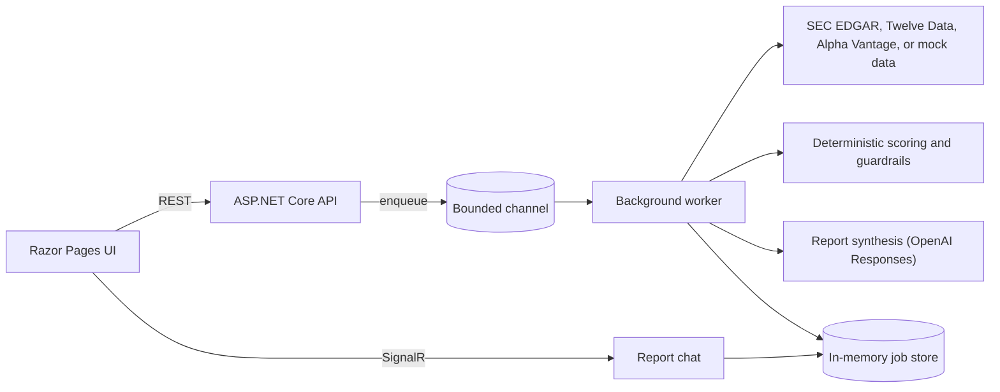

# Proofsheet

Proofsheet is an AI research analyst for US public companies, built with .NET 10. Give it a ticker and it collects the company's SEC EDGAR filings and financial data, runs the research as a background job you can follow step by step, and returns a structured report. The report's thesis, insights and signal each cite the sources behind them. You can then chat with the finished report, and the answers stay grounded in it.

> Proofsheet is a portfolio and research project. Nothing it produces is investment advice.

## Quick start

You don't need any API keys: without them, Proofsheet runs on seeded sample data. You need the [.NET 10 SDK](https://dotnet.microsoft.com/download/dotnet/10.0).

```bash
git clone https://github.com/Eslam93/proofsheet.git
cd proofsheet
dotnet run --project Proofsheet.Api --launch-profile http
```

Open <http://localhost:5214>, search for a company, and generate a report. The API's Swagger UI is at <http://localhost:5214/swagger>. For more detail, see the [no-keys quickstart](docs/quickstart-no-keys.md).

## What it does

- **Research jobs.** Submitting a ticker queues a job on a bounded in-process queue, and a hosted worker runs it. While it runs, the status endpoint reports each step, warning and source.
- **Data.** SEC EDGAR supplies company identity, recent filings and XBRL financial statements. Twelve Data (a market quote) and Alpha Vantage (news) are optional.
- **Reports.** Each report has a company, thesis, signal (Bullish, Neutral or Bearish), confidence, two to five insights, and the sources behind every claim, plus which provider supplied each figure. A model writes the report through the OpenAI Responses API. Deterministic checks then bound its confidence and can overrule its signal.
- **Two ways to research.** *Standard* runs a fixed multi-step pipeline. *Autonomous* has a model coordinator call research tools and hand an evidence package to a specialist, which drafts, critiques and repairs the report.
- **Report chat.** A SignalR chat answers questions using only the completed report. It has tools to look up sources and trace steps, and its streaming survives reconnects.
- **Run modes.**
  - `Mock`: seeded data, no keys.
  - `Hybrid`: live data, falling back to mock where a provider fails.
  - `LiveRequired`: live data only.
  - `Auto` (the default): picks Mock or LiveRequired depending on what is configured.

## How it works



The solution is split into layers:
- `Proofsheet.Domain`: models and deterministic scoring.
- `Proofsheet.Application`: orchestration and the job state machine.
- `Proofsheet.Infrastructure`: data providers, model clients, the queue and the stores.
- `Proofsheet.Api`: controllers, Razor Pages and the SignalR hub.

## Engineering notes

**Picking the right numbers out of SEC XBRL.** SEC company facts mix several kinds of figure:
- full fiscal years
- fourth quarters reported inside 10-Ks
- trailing-twelve-month figures reported inside 10-Qs
- restated years
- concepts companies have stopped using

The first version of Proofsheet used the first concept on a list and the two latest facts. Across 52 large companies, 27 of the 35 statements it could build had at least one wrong figure. Microsoft, for example, came out as fiscal 2010 with a 248% operating margin.

The fix is [`SecFactSelector`](Proofsheet.Infrastructure/Clients/SecFactSelector.cs):
- A fiscal year is a fact from an annual report that spans 350 to 380 days.
- Revenue comes from the concept the company still reports.
- Every other figure is pinned to that same fiscal year.

It is tested against trimmed real SEC data for 14 companies. The expected values come from a [separate JavaScript implementation](Proofsheet.Tests.Unit/Fixtures/Sec/reference.js), and the selected revenue matches each company's published results.

**Models inside guardrails.** The model writes the report, but the backend has the final say:
- Cited source IDs must exist.
- The number of insights and the confidence are bounded.
- Weak evidence forces a Neutral signal.

**Observable by design.** Every job records a trace of its steps, retries and fallbacks. Every report records which provider supplied each figure and whether the data was live or seeded.

## Configuration

Settings come from `Proofsheet.Api/appsettings.json`, environment variables, and user secrets. To run against live data, set these:

```bash
ResearchJobs__Mode=LiveRequired
SecEdgar__Enabled=true
SecEdgar__UserAgent="Proofsheet/1.0 you@example.com"   # SEC asks for contact details
TwelveData__Enabled=true
TwelveData__ApiKey=...
AlphaVantage__Enabled=true
AlphaVantage__ApiKey=...
OpenAiResponses__Enabled=true
OpenAiResponses__ApiKey=...
```

Every setting and its default is listed in the [reference](docs/reference.md#configuration).

## API

| Method | Path | Purpose |
|---|---|---|
| `POST` | `/api/v1/research-jobs` | Submit a job, for example `{ "identifier": "AAPL", "researchMode": "Standard" }` |
| `GET` | `/api/v1/research-jobs/{jobId}` | Status, current step, warnings and trace |
| `GET` | `/api/v1/research-jobs/{jobId}/result` | The finished report (`202` while the job runs) |
| `GET` | `/api/v1/tickers/search?q=ap` | Ticker and company search |
| `GET` | `/health` | Health check |
| SignalR | `/hubs/report-chat` | Report chat |

Errors are returned as RFC 7807 problem details.

## Tests

```bash
dotnet test Proofsheet.slnx
```

There are 77 tests: 61 unit and 16 integration. They cover the real SEC fixtures, the fact-selection edge cases, the API and SignalR flows, and the UI pages, and they run without any keys.

## Docker

```bash
docker build -t proofsheet .
docker run --rm -p 8080:8080 proofsheet
```

The image runs as a non-root user and listens on port 8080. It is not built in CI yet.

## Limitations

- Jobs, reports and chat threads are kept in memory and are lost on restart. There is no authentication.
- Live statements need the standard US GAAP concepts. Banks, oil majors and many pharmaceutical companies don't report operating income that way, so they fall back with a reason. In a test of 52 large companies, 37 got a live statement.
- The signal and confidence come from heuristics and a language model. Treat them as a demonstration, not a recommendation.
- Autonomous mode is an early version: its coordinator chooses the order and repetition of a fixed set of research tools.

## Roadmap

The direction is verifiability: every claim in a report should be checkable against the filing it came from.

- Read 10-K sections such as risk factors and MD&A, and cite claims down to the paragraph.
- Check every quoted passage and number in code before a report is shown.
- Run model evaluations in CI against recorded HTTP traffic, so they need no keys, and publish a static gallery of sample reports.
- Add CI that builds, tests, and publishes the container image.

## Background

Proofsheet started as an implementation of the A.I.R.A case study, a take-home brief for an autonomous investment-research backend.
- [Case study coverage](docs/case-study-coverage.md) maps the brief's requirements to the implementation.
- The [reference](docs/reference.md) keeps the full original documentation: architecture, job lifecycle, modes, the result contract and configuration.

## License

[MIT](LICENSE)
